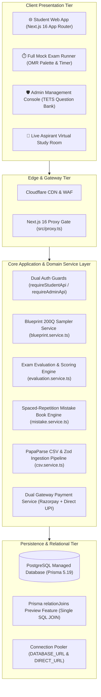
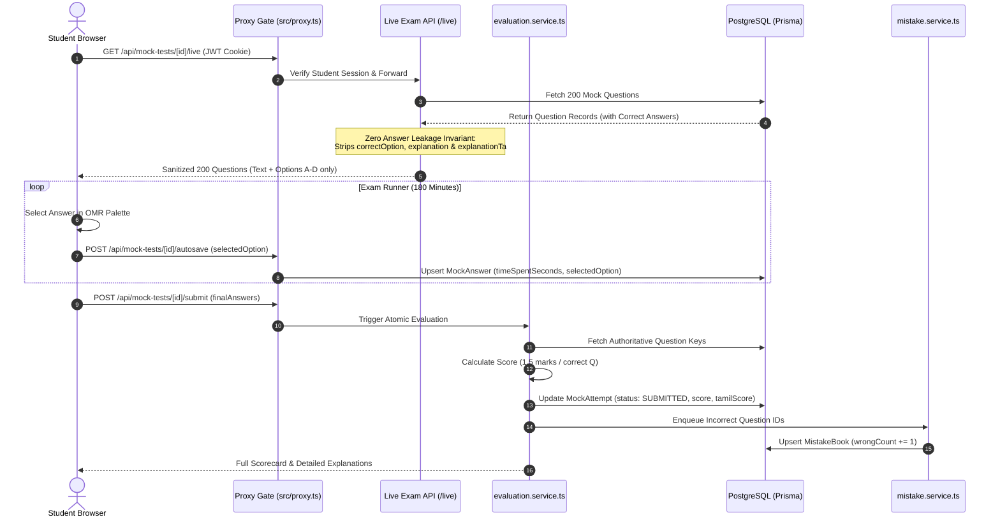

# 🏛️ TargetTNgrp4 — System Architecture

This document details the architectural blueprint, component interactions, data boundaries, and execution flows powering the **TargetTNgrp4** platform.

---

## 1. Architectural Philosophy

TargetTNgrp4 is architected as a **Modular Monolith** using the **Next.js 16 App Router** paired with a strictly partitioned service layer in TypeScript. This structure delivers rapid developer velocity while enforcing uncompromising boundaries between student-facing exam runners and administrative governance tools.

---

## 2. Layered Component Architecture

### 2.1 Edge & Security Tier
- **Cloudflare Edge:** Delivers global DNS resolution, SSL/TLS termination, DDoS mitigation, and asset caching for static frontend bundles and images.
- **Next.js 16 Proxy Gate (`src/proxy.ts`):** Instead of legacy `middleware.ts`, TargetTNgrp4 routes requests through a unified `proxy()` handler that validates session cookies, checks route access permissions, enforces CSRF headers on admin mutations, and rewrites authorized paths.

### 2.2 Application Services Tier
All business logic is isolated into domain services (`src/lib/`), ensuring that Next.js API route handlers remain thin input/output controllers:

- **Dual Authentication Guards:**
  - `requireStudentApi(req)`: Validates the stateless HMAC-signed JWT stored in `targettn_student_session`, injecting student context without requiring a database query on high-frequency exam calls.
  - `requireAdminApi(req)`: Validates the stateful session cookie `tnpsc_admin` against the `admin_sessions` table by computing the SHA-256 hash of the presented token, verifying expiration, and confirming admin role.
- **Blueprint 200-Question Sampler (`blueprint.service.ts`):** Selects questions matching the official TNPSC Group 4 blueprint:
  - 100 Questions: General Tamil (Part A) from `Unit: Ilakkanam`, `Unit: Ilakkiyam`, `Unit: Tamil Arignargal`.
  - 75 Questions: General Studies (Part B) across History, Polity, Geography, Economy, Science, and Current Affairs.
  - 25 Questions: Aptitude & Mental Ability (Part C) across Simplification, Ratio, HCF/LCM, and Percentages.
  - Applies difficulty distribution: ~30% Easy, ~50% Medium, ~20% Hard.
- **Server Evaluation & Scoring Engine (`evaluation.service.ts`):** Evaluates candidate answer selections upon submission. Computes total marks ($1.5 \times \text{correct}$), accuracy percentage, Part A/B/C sub-scores, and generates time-per-question metrics.
- **Mistake Book Spaced-Repetition Engine:** Automatically creates or increments `MistakeBook` records for every incorrectly answered question. Tracks consecutive correct answers in revision tests until the mastery threshold is reached.
- **PapaParse CSV Ingestion Pipeline:** Streams and validates bulk question uploads via Zod schemas, enforcing bilingual field consistency before performing transactional batch inserts (`createMany`).
- **Payment & Webhook Engine:** Manages Razorpay order generation and verifies webhook signatures via cryptographic HMAC-SHA256 (`webhookVerifier.ts`). Supports manual UPI receipt generation and admin verification.

### 2.3 Data & Persistence Tier
- **Managed PostgreSQL Database:** High-availability PostgreSQL database accessed through Prisma ORM 5.19.
- **Optimized Relation Joins:** Configured with `previewFeatures = ["relationJoins"]` to execute single SQL `LEFT JOIN` queries instead of multiple sequential queries for nested relational graphs (e.g. `MockTest` $\rightarrow$ `MockTestQuestion` $\rightarrow$ `Question`).
- **Connection Pooling:** Separates transactional pooled connection (`DATABASE_URL`) from direct administrative migration connection (`DIRECT_URL`).

---

## 3. Exam Execution Lifecycle & Zero-Leakage Sequence

---

## 4. Key Architectural Decisions (ADRs)

| Area | Decision | Architectural Rationale |
|---|---|---|
| **Framework** | Next.js 16 App Router | Unified TypeScript frontend/backend with React 19 Server Components for instant initial page loads and SEO. |
| **Code Modularity** | Strict 150-Line Limit | Forces atomic UI components and dedicated service layers, preventing monolithic maintainability debt. |
| **Exam Integrity** | Zero Answer Leakage API | Eliminates client-side inspection vulnerabilities in browser DevTools during active examination sessions. |
| **Scoring Engine** | Server-Side Evaluation | Authoritative grading guarantees tamper-proof scores, percentile calculations, and state rank integrity. |
| **ORM & Joins** | Prisma 5 with `relationJoins` | Reduces query latency from 3–5 round trips to a single SQL JOIN for complex 200-question mock structures. |
| **Authentication** | Dual Independent Gateways | Isolates high-frequency student JWT sessions from critical, stateful admin sessions requiring immediate revocation. |
| **Table Architecture**| Universal Table Standard (TETS)| Server-side SQL pagination with debounced search prevents browser memory bloat across 10,000+ question banks. |
| **Payment Security** | HMAC-SHA256 Webhook Verifier | Ensures payment state transitions occur only upon cryptographically verified Razorpay notifications. |

---

## 5. Scalability & Resilience

- **Fail-Closed Protection:** All student and admin APIs reject unauthorized or malformed requests with `401 Unauthorized` or `403 Forbidden` before invoking database queries.
- **Zero N+1 Query Policy:** Bulk database operations strictly utilize Prisma batch operators (`findMany({ where: { id: { in: ids } } })`, `createMany`).
- **Autosave Network Buffering:** The exam runner buffers question response states in browser `localStorage` and synchronizes with the server asynchronously, allowing students to seamlessly survive momentary Wi-Fi interruptions.
- **Admin Session Pruning:** Automated maintenance scripts (`npm run admin:prune`) purge expired admin authentication tokens, keeping database indexes compact and responsive.
