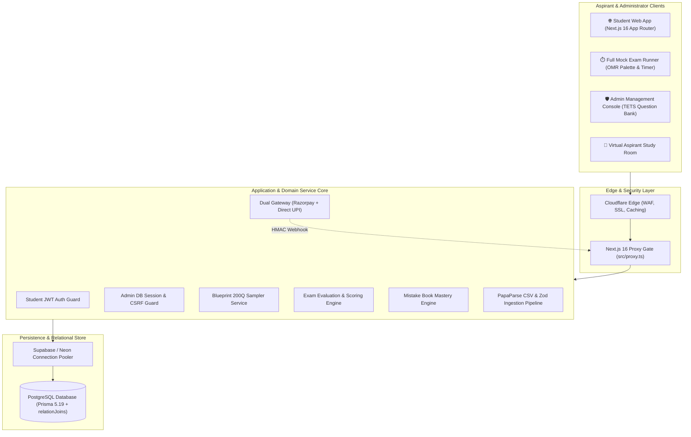
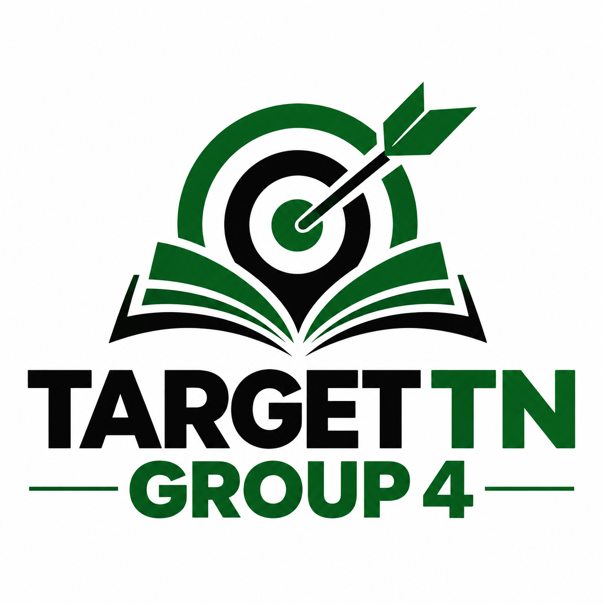

# 🎯 TargetTNgrp4 — Enterprise Bilingual Exam Engine & Aspirant Operating Platform

> **A high-performance, bilingual (Tamil & English) SaaS mock examination engine, syllabus practice platform, and automated mistake diagnostic system engineered for TNPSC Group 4 aspirants.**

---

## 📌 Notice
*This is a public technical showcase repository documenting the system architecture, domain design, exam simulation invariants, and engineering standards of TargetTNgrp4. The proprietary production question bank and application secrets remain private.*

---

## 💡 The Problem

The Tamil Nadu Public Service Commission (TNPSC) Group 4 examination is one of the largest competitive state examinations in India, attracting over **2,000,000 applicants** annually for fewer than 10,000 government positions (VAO, Junior Assistant, Typist, Bill Collector). Aspirants face severe structural challenges:

- **Cutoff Intensity & Zero Margin for Error:** General category cutoffs frequently exceed **260–270 marks out of 300** (170+ correct answers out of 200). A single misread question costs thousands of state rank positions.
- **Language Duality & Samacheer Kalvi Nuance:** Part A (General Tamil) requires exact command over Tamil literature, grammar, and authors across 6th to 12th standard textbooks. Generic national test-prep platforms lack authentic Tamil-medium formatting and font nuances.
- **Exam Stamina Deficit:** The official paper demands answering **200 questions in 180 minutes** (54 seconds per question). Without authentic timer-driven, full-length simulations, aspirants run out of time during Part C (Aptitude).
- **Unstructured Mistake Rectification:** Aspirants repeatedly repeat identical conceptual errors because paper mock tests provide no automated spaced-repetition feedback or tracking mechanism.

---

## 🚀 The Solution: TargetTNgrp4

TargetTNgrp4 provides a rigorous, production-grade examination operating platform built specifically around the TNPSC Group 4 blueprint:

1. **Authentic 200-Question Exam Simulation:** Exact 1:1 blueprint replication (Part A: 100 General Tamil, Part B: 75 General Studies, Part C: 25 Aptitude) with a 180-minute countdown, OMR-style palette, and persistent client-side autosave.
2. **Server-Side Scoring with Zero Answer Leakage:** Live exam APIs strip all answer keys and explanations before transmission, eliminating client-side inspection exploits. All evaluations occur server-side upon atomic submission.
3. **Automated Spaced-Repetition "Mistake Book":** Every incorrect attempt across mock exams and practice tests automatically registers into a personal Mistake Book with consecutive-correct mastery tracking.
4. **Universal Enterprise Table Standard (TETS):** Admin question bank management features server-side pagination, debounced search, tab count aggregations, and PapaParse CSV bulk ingestion with Zod validation.
5. **Dual Independent Security Model:** Complete physical and logical isolation between student session management (stateless signed JWT) and administrative governance (stateful SHA-256 hashed DB sessions with CSRF origin guards).
6. **Dual Payment Engine:** Razorpay order workflows with cryptographic HMAC-SHA256 webhook verification alongside direct manual UPI approvals.

---

## 🏗️ System Architecture at a Glance

---

## 🧩 Core Platform Components

| Subsystem | Primary Tech Stack | Description |
|---|---|---|
| **Exam State Runner** | Next.js 16, React 19, Lucide Icons | Real-time 200Q test runner with section tabs, OMR answer palette, countdown timer, network disruption resilience, and autosave. |
| **Server Evaluation Core** | Node.js, Prisma 5.19, Zod 4 | Server-side scoring engine enforcing zero answer leakage, section-wise mark attribution (1.5 marks/Q), and percentile ranking. |
| **Topic Practice Engine** | React 19, Server Actions, Tailwind CSS 4 | Granular practice partitioned by Section $\rightarrow$ Unit $\rightarrow$ Topic with immediate bilingual feedback and answer rationales. |
| **Mistake Book Engine** | Prisma ORM, PostgreSQL | Automated wrong-answer logging with spaced-repetition re-tests and consecutive-correct mastery thresholds. |
| **Admin Question Bank** | TETS Architecture, PapaParse, Zod | Enterprise question curator with server-side pagination, live status tab counts, bilingual preview modals, and bulk CSV ingestion. |
| **Monetization & Gateways** | Razorpay SDK, Webhook HMAC, Crypto | Tiered subscription passes (30 Days, 90 Days Pro) with dual Razorpay/Cashfree switching and manual UPI approval workflows. |

---

## 🛡️ Key Engineering Highlights

### 1. Strict 150-Line Limit per File (Clean Code Standard)
Every source code file across the repository strictly enforces a maximum length of **150 lines**. UI components are decomposed into cohesive atomic units, complex state logic is extracted into dedicated hooks, and business logic lives exclusively in domain services.

### 2. Server-Side Scoring & Zero Answer Leakage Invariant
To ensure competitive exam integrity, live exam payload endpoints (`/api/mock-tests/[id]/live`) strip `correctOption`, `explanation`, and `explanationTa` before delivering questions to the browser. Answer verification and score computation occur strictly within `evaluation.service.ts` upon submission.

### 3. Dual Independent Authentication Gateways
The platform separates student and administrator privileges into two entirely independent security domains:
- **Students:** Stateless signed JWT stored in the `targettn_student_session` HTTP-only cookie.
- **Administrators:** Stateful DB-persisted session (`admin_sessions` table) storing only the SHA-256 hash of the token, validated with CSRF origin headers (`tnpsc_admin` cookie).

### 4. Universal Enterprise Table Standard (TETS)
All data tables implement server-side SQL pagination (`skip`/`take`), dynamic page sizing (10, 20, 50, 100), 400ms debounced search, real-time database tab counts via `db.$transaction`, and baseline Tamil font alignment.

### 5. Native Bilingual Schema (Tamil & English)
Database entities feature dedicated fields for English (`questionText`, `optionA`–`D`, `explanation`) and Tamil (`questionTextTa`, `optionATa`–`DTa`, `explanationTa`). The frontend switches effortlessly between Tamil, English, and bilingual split-screen modes.

---

## 📚 Technical Documentation Index

Explore the comprehensive technical architecture and domain specifications:

- 🏛️ **[System Architecture](ARCHITECTURE.md)** — In-depth component breakdowns, proxy gating, and sequence flows
- ⚙️ **[Tech Stack Rationale](TECH_STACK.md)** — Architectural justification for Next.js 16, React 19, Tailwind CSS 4, and Prisma 5
- 📝 **[TNPSC Group 4 Exam Blueprint](docs/domain/tnpsc-exam-model.md)** — 200 Questions, 300 Marks, 3 Hours, Part A/B/C breakdown
- 📚 **[Syllabus & Curriculum Hierarchy](docs/domain/syllabus-hierarchy.md)** — Section $\rightarrow$ Unit $\rightarrow$ Topic taxonomy & Samacheer Kalvi alignment
- 🔄 **[Aspirant Lifecycle & Study Loop](docs/domain/student-lifecycle.md)** — Journey from onboarding to daily targets, mocks, and rank prediction
- 🔌 **[API Design & TETS Standards](docs/engineering/api-design.md)** — `ApiResponse<T>`, Zod schemas, debounced pagination, and error handling
- 🔐 **[Dual Authentication & Security Architecture](docs/engineering/dual-auth-security.md)** — Stateless student JWT vs DB-backed admin sessions
- ⚡ **[Exam Engine & Server-Side Scoring](docs/engineering/exam-engine-scoring.md)** — Zero answer leakage, autosave sync, and Mistake Book automation
- 🚀 **[Deployment & Cloud Topology](docs/engineering/deployment.md)** — Next.js 16 deployment, Prisma pooling, environment secrets, and scripts
- 🎓 **[Student Portal Deep Dive](docs/product/student-portal.md)** — Aspirant dashboard, daily targets, analytics, and study rooms
- 🛠️ **[Admin Console Deep Dive](docs/product/admin-portal.md)** — TETS question management, CSV import pipeline, and manual UPI approval
- ⏱️ **[Exam Simulation Runner](docs/product/exam-runner.md)** — Real-time OMR palette, timer bar, network resilience, and scorecard diagnostics

---

## 📸 Screenshots & Previews

  

Comprehensive UI catalog detailing Public Landing, Student Dashboard, Exam Runner, Results Analytics, and Admin Console: **[`screenshots/README.md`](screenshots/README.md)**.

---

## 📄 License & Private Repository Notice

The TargetTNgrp4 platform name, exam simulation architecture, question bank schema, and documentation are proprietary assets. All rights reserved. For institutional licensing or partnership inquiries, contact the platform engineering team.
