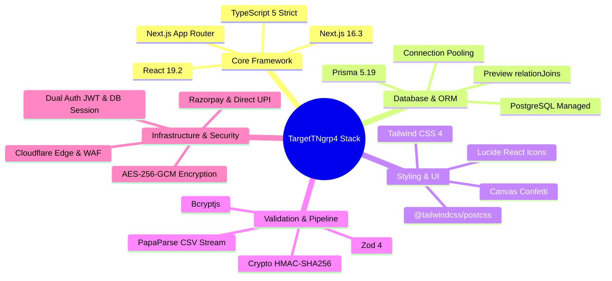

# ⚙️ TargetTNgrp4 — Technology Stack & Engineering Rationale

This document details the engineering choices behind TargetTNgrp4's architecture and the technical rationale for each selection.

---

## 1. Technology Matrix

---

## 2. Framework & Backend Stack Rationale

### Next.js 16 (App Router) + React 19
- **Choice:** Next.js 16 App Router utilizing React 19 Server Components and Client Components.
- **Rationale:**
  - **Unified Monolith Velocity:** Combining full-stack TypeScript API route handlers with React Server Components eliminates API client code duplication and enables rapid iteration.
  - **Server-Side Rendered Landing Pages:** Public SEO pages (`/`, `/syllabus`, `/pricing`) render as lightweight static HTML, providing fast First Contentful Paint (FCP) on mobile networks across Tamil Nadu.
  - **Direct Stream Processing:** Server actions and API routes efficiently stream data for live exam evaluations, bulk CSV ingestion, and student analytics aggregations.

### Prisma ORM 5.19 + PostgreSQL
- **Choice:** Prisma 5.19 connected to high-availability PostgreSQL with pooled connections.
- **Rationale:**
  - **End-to-End Type Safety:** Strongly typed database client generated directly from `schema.prisma` guarantees compile-time validation for questions, mock attempts, and student analytics.
  - **`relationJoins` Preview Engine:** Leverages Prisma's preview feature to compile complex nested queries (Mock Test $\rightarrow$ Questions $\rightarrow$ Bookmarks) into a single optimized SQL `LEFT JOIN` query instead of multiple serial network round-trips.
  - **Dual Connection Pool Support:** Configured with `DATABASE_URL` for pooled application traffic and `DIRECT_URL` for safe schema migrations and seed scripts.

### Zod 4 Schema Validation
- **Choice:** Zod 4 for runtime type validation across all network boundaries.
- **Rationale:**
  - **Strict Request Contracts:** Validates every incoming HTTP body and query parameter before execution reaches domain services.
  - **CSV Ingestion Validation:** Guards bulk question ingestion by validating bilingual fields, correct option values (`A`, `B`, `C`, `D`), difficulty levels, and section strings row-by-row.

---

## 3. Frontend Web & UI Stack Rationale

### Tailwind CSS 4 (`@tailwindcss/postcss`)
- **Choice:** Tailwind CSS 4 utilizing modern PostCSS integration without legacy configuration files.
- **Rationale:**
  - **Utility-First Performance:** Zero runtime overhead with compile-time CSS purging ensures minimal payload size over 4G/3G mobile connections.
  - **Theme Consistency:** CSS variables configured in `globals.css` provide unified design tokens across exam timers, status badges, and Tamil typography.
  - **High-Density Data Display:** Clean layout utilities power the Universal Enterprise Table Standard (TETS) for high-density question lists and analytics tables.

### Lucide React Icons
- **Choice:** Tree-shakeable SVG icon library.
- **Rationale:** High-performance, lightweight icons for the exam palette (flagged, answered, visited, unvisited), navigation menus, and status badges without bundle bloat.

### Canvas Confetti
- **Choice:** Lightweight canvas animation library.
- **Rationale:** Delivers celebratory feedback upon completing 200-question mock exams, hitting daily target streaks, and mastering items in the Mistake Book.

---

## 4. Ingestion, Security & Payments Rationale

### PapaParse CSV Streaming
- **Choice:** Stream-oriented CSV parsing library with automatic header mapping.
- **Rationale:** Allows administrators to bulk-upload thousands of bilingual questions exported from spreadsheets with instant error detection and preview before database insertion.

### Dual Independent Authentication
- **Choice:** Stateless signed JWT for students; DB-backed SHA-256 hashed sessions for administrators.
- **Rationale:**
  - **Student Scale:** Eliminates database session read bottlenecks during concurrent exam attempts by verifying JWT signatures statelessly via HTTP-only cookies.
  - **Administrative Security:** Stateful sessions stored in `admin_sessions` enable instant single-click revocation, brute-force IP tracking via `login_attempts`, and comprehensive admin action logging via `admin_audit_logs`.

### Dual Payment Gateway & AES-256-GCM Encryption
- **Choice:** Razorpay SDK with fallback switching and encrypted database settings.
- **Rationale:**
  - **Encrypted Credentials:** Production payment secrets are stored encrypted at rest using AES-256-GCM (`PAYMENT_SETTINGS_ENCRYPTION_KEY`).
  - **Webhook Cryptographic Integrity:** All payment transitions (PENDING $\rightarrow$ SUCCESS) require cryptographic HMAC-SHA256 signature verification.
  - **Direct Manual UPI Support:** Catches students without credit cards/netbanking via direct UPI QR payment and UTR reference submission, verified manually via the admin portal.

---

## 5. Engineering Standards & Code Quality Invariants

| Standard | Rule | Implementation & Verification |
|---|---|---|
| **Max File Length** | $\le 150$ lines per file | Verified via `node ../agents/scripts/count-lines.js`. Zero tolerance for monoliths. |
| **Database Performance** | Zero N+1 queries | Prisma batch operators (`findMany({ where: { id: { in: ids } } })`, `createMany`). |
| **Exam Integrity** | Zero Answer Leakage | Live exam payloads strip all answer keys and explanations before network transmission. |
| **API Envelope** | Unified `ApiResponse<T>` | Standardized JSON contract `{ success, message, data, error }` across all endpoints. |
| **Bilingual Compliance**| Tamil UTF-8 + English | Dual database attributes (`questionText` / `questionTextTa`) and dynamic i18n context. |
