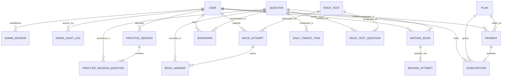

# 📊 Diagram: Database Entity Relationship (ERD)

Core domain entities and relational mappings enforcing bilingual question management, exam simulation states, mistake tracking, and subscription governance.

---

## Key Model Attributes & Constraints

| Entity | Primary Keys & Indexes | Key Attributes | Invariant / Purpose |
|---|---|---|---|
| **`User`** | `id` (UUID), `email` (Unique) | `role`, `fullName`, `languagePref`, `district`, `targetExam` | Multi-role user model (`STUDENT`, `ADMIN`) with district demographic tracking. |
| **`AdminSession`** | `id` (UUID), `tokenHash` (Unique) | `userId`, `ipAddress`, `userAgent`, `expiresAt`, `revokedAt` | Stateful administrative session storing only SHA-256 hash of presented token. |
| **`Question`** | `id` (UUID) | `questionText`, `questionTextTa`, `optionA`–`D`, `optionATa`–`DTa`, `correctOption`, `section`, `unit`, `topic`, `difficulty` | Bilingual question entity. live exam APIs strictly sanitize `correctOption` and explanations. |
| **`MockTest`** | `id` (UUID), `slug` (Unique) | `title`, `totalQuestions` (200), `durationMinutes` (180), `totalMarks` (300.0), `isPremium`, `isPublished` | Curated 200-question mock test metadata matching official TNPSC blueprint. |
| **`MockAttempt`** | `id` (UUID) | `userId`, `mockTestId`, `status`, `score`, `tamilScore`, `aptitudeScore`, `accuracyPercentage`, `timeSpentSeconds` | Student exam attempt state machine (`IN_PROGRESS`, `SUBMITTED`, `ABANDONED`). |
| **`MockAnswer`** | `id` (UUID), Unique(`mockAttemptId`, `questionId`) | `selectedOption`, `isMarkedForReview`, `isVisited`, `timeSpentSeconds` | Granular response tracking per question for OMR palette and telemetry. |
| **`MistakeBook`**| `id` (UUID), Unique(`userId`, `questionId`) | `wrongCount`, `consecutiveCorrect`, `isMastered`, `masteredAt` | Personal mistake tracking with spaced-repetition mastery loop. |
| **`Payment`** | `id` (UUID), `receiptNumber` (Unique) | `userId`, `planId`, `gateway`, `amountInr`, `status`, `utrReference` | Dual-gateway payment records (`RAZORPAY`, `CASHFREE`, `MANUAL_UPI`). |
| **`Subscription`**| `id` (UUID) | `userId`, `planId`, `startDate`, `endDate`, `status` | Active premium access pass governing mock exam and analytics entitlements. |
