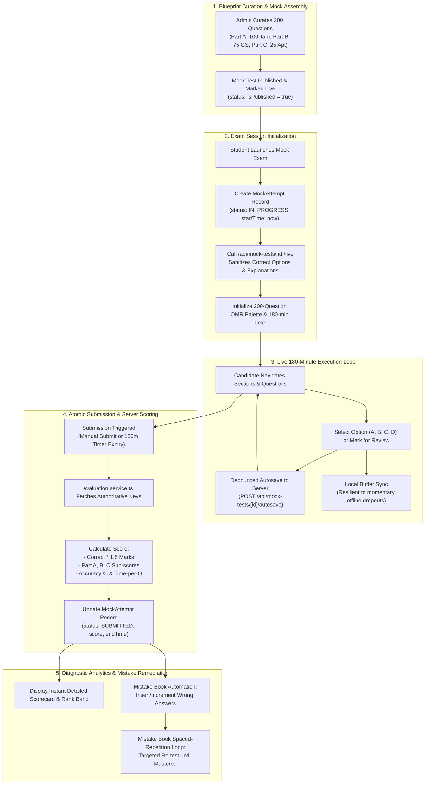

# 📊 Diagram: Exam Lifecycle & State Machine Flow

End-to-end operational flow of a TNPSC Group 4 mock examination attempt: from blueprint curation and live simulation runner to server-side evaluation and automated mistake rectification.

