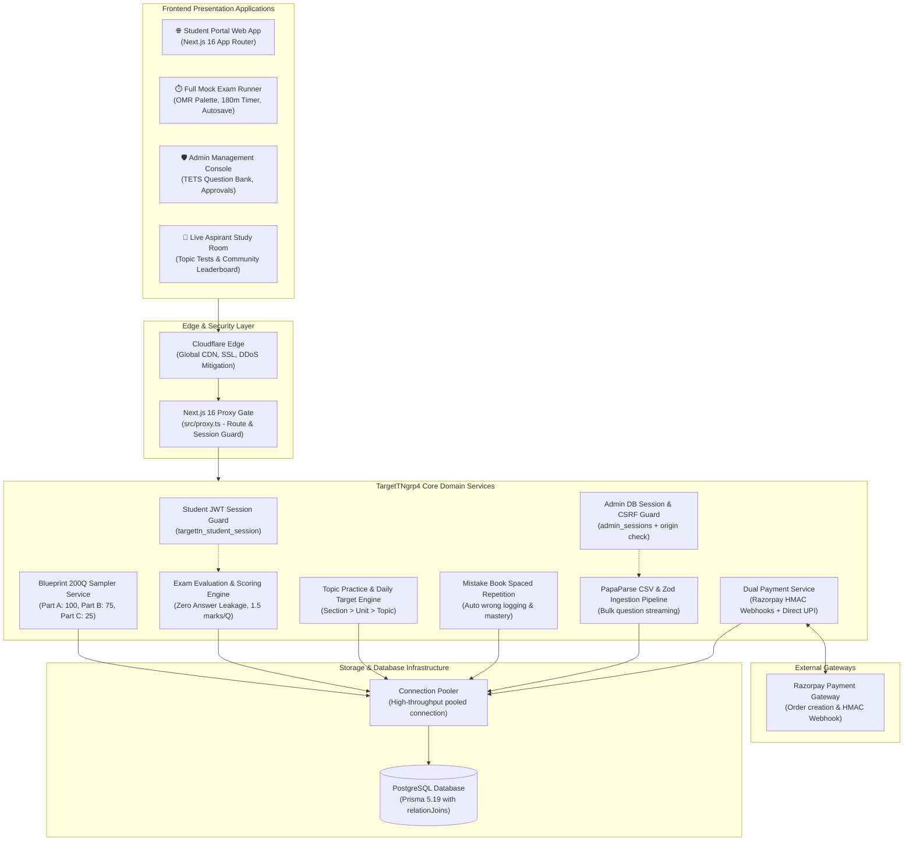

# 📊 Diagram: System Architecture

High-level component layout and interaction channels across TargetTNgrp4 client applications, edge security layers, domain services, and persistence infrastructure.

