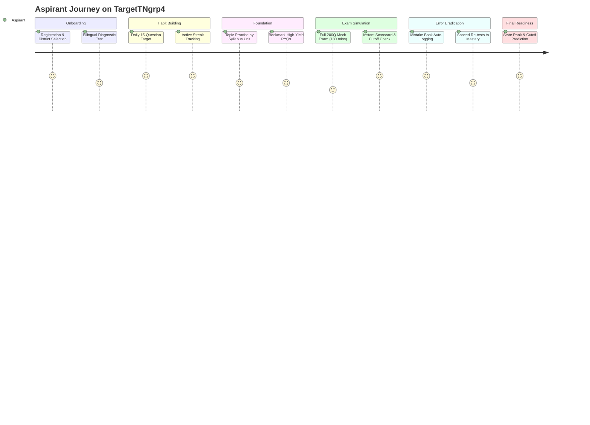

# 🔄 Domain Model: Aspirant Lifecycle & Habit Loop

This document outlines the six-stage preparation lifecycle of a TNPSC Group 4 candidate on TargetTNgrp4, detailing how daily micro-habits compound into state-level rank readiness.

---

## 1. Six-Stage Aspirant Progression

---

## 2. Stage Breakdown & Operational Logic

### Stage 1: Registration & Diagnostic Calibration
- Aspirant registers via phone/email and selects **Language Preference** (`TAMIL` or `ENGLISH`) and **Home District** (one of the 38 Tamil Nadu districts).
- Takes a free Starter Mock Test to establish a baseline proficiency score across Part A, Part B, and Part C.

### Stage 2: Daily Target Routine & Habit Loop
- Every morning at 00:00 IST, `daily_target_items` schedules a fresh 15-question mini-sprint.
- Completing the 15 questions logs a `PracticeSession` with `targetDate = today` and increments the candidate's active daily streak.

### Stage 3: Topic Practice & Weak Area Shoring
- For areas identified as weak during the diagnostic test (e.g. தமிழ் இலக்கணம் or Aptitude Simplification), the candidate engages in targeted topic practice.
- Receives immediate bilingual explanations and marks tricky questions as `Bookmark` for future revision.

### Stage 4: Full 200-Question Exam Simulation
- As exam day nears, candidates attempt full-length 200-question mock tests under strict 180-minute timed conditions.
- Candidates experience authentic cognitive fatigue, practice time-management strategies (e.g. allocating 70 mins for Tamil, 70 mins for GS, 40 mins for Aptitude), and navigate the 200-bubble OMR palette.

### Stage 5: Automated Mistake Remediation Loop
- Any question missed during a full mock or topic practice automatically enters `MistakeBook`.
- Instead of re-reading entire textbooks, candidates take targeted 10- or 25-question re-tests drawn exclusively from their unmastered mistakes.
- Once answered correctly twice in a row (`consecutiveCorrect = 2`), the question transitions to `isMastered = true`.

### Stage 6: Final Rank & State Cutoff Prediction
- The analytics engine aggregates recent test performances to predict expected marks against actual historical cutoffs for the candidate's district and category.
- Provides actionable recommendations (e.g. "Increase Part C accuracy from 19/25 to 23/25 to reach the top 500 state rank band").
