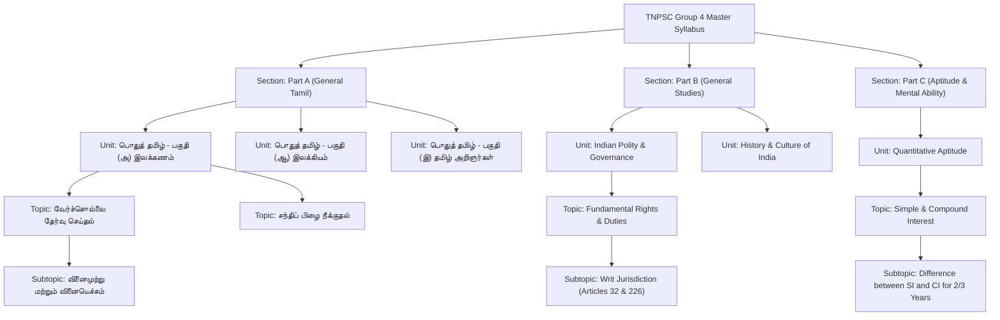

# 📚 Domain Model: Syllabus Hierarchy & Taxonomy

This document outlines the hierarchical taxonomy, Samacheer Kalvi school curriculum mapping, and bilingual database representation implemented across TargetTNgrp4's question bank.

---

## 1. Curricular Taxonomy Structure

TargetTNgrp4 organizes the exhaustive TNPSC Group 4 syllabus into a strict 4-level hierarchy:



---

## 2. Bilingual Database Representation

To guarantee fidelity across both Tamil-medium and English-medium aspirants, the `Question` model implements dual bilingual fields:

```prisma
model Question {
  id             String   @id @default(uuid())
  // English / Base fields
  questionText   String
  optionA        String
  optionB        String
  optionC        String
  optionD        String
  explanation    String

  // Tamil (*Ta) fields
  questionTextTa String?
  optionATa      String?
  optionBTa      String?
  optionCTa      String?
  optionDTa      String?
  explanationTa  String?

  correctOption  String   // "A" | "B" | "C" | "D"
  section        String   // "Part A", "Part B", "Part C"
  unit           String   // e.g. "Indian Polity", "Ilakkanam"
  topic          String   // e.g. "Fundamental Rights"
  subtopic       String?
  difficulty     String   @default("MEDIUM") // EASY | MEDIUM | HARD
  language       String   @default("TAMIL")  // TAMIL | ENGLISH | BILINGUAL
  source         String?  // e.g. "10th Samacheer Kalvi Civics Unit 1"
}
```

### Bilingual Handling Contract:
- **`language = TAMIL`:** Base fields contain Tamil text; `*Ta` fields are left `null`.
- **`language = ENGLISH`:** Base fields contain English text; `*Ta` fields are left `null`.
- **`language = BILINGUAL`:** Base fields hold English strings, while `*Ta` fields hold Tamil strings. The frontend renders both side-by-side or allows the candidate to toggle preferred language with a single click.

---

## 3. Samacheer Kalvi Textbook Mapping

The TNPSC Group 4 syllabus is officially grounded in the Tamil Nadu State Board (Samacheer Kalvi) curriculum:

| Subject Domain | Prescribed Standard | Core Books & Focus Chapters |
|---|---|---|
| **General Tamil** | Classes 6th to 12th | Samacheer Kalvi Tamil textbooks (Old & New Editions). Special emphasis on 9th & 10th standard grammar and 11th & 12th special Tamil. |
| **Science** | Classes 6th to 10th | Samacheer Kalvi Science (Physics, Chemistry, Biology). Key chapters: Human Physiology, Nutrition, Motion, Genetics. |
| **Social Science** | Classes 6th to 10th | Samacheer Kalvi History, Civics, Geography, and Economics. Essential focus on Indian Constitution and TN Geography. |
| **History & Heritage** | Classes 11th & 12th | Higher Secondary History and Ethics books for Unit 8 (Tamil Society, Archeological Excavations like Keeladi, Sangam Age). |
