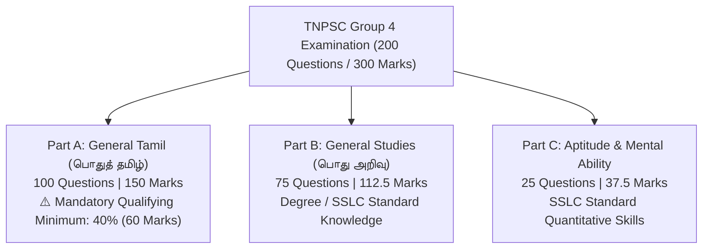

# 📝 Domain Model: TNPSC Group 4 Examination Blueprint & Rules

This document specifies the official examination rules, curricular sections, scoring formulation, and cutoff criteria governing the TNPSC Group 4 competitive examination.

---

## 1. Official Examination Blueprint

The Tamil Nadu Public Service Commission Group 4 examination consists of a single objective-type paper administered for **300 total marks** across **200 multiple-choice questions** over **3 hours (180 minutes)**.

---

## 2. Part-Wise Curricular Specification

### Part A: General Tamil (பொதுத் தமிழ்)
- **Weightage:** 50% of the entire examination ($100$ Questions / $150$ Marks).
- **Mandatory Qualifying Requirement:** Candidates **must score at least 40% (60 marks)** in Part A; otherwise, Part B and Part C answer sheets are legally invalidated and not evaluated.
- **Curriculum Units (Samacheer Kalvi 6th to 12th Standard):**
  1. **பகுதி (அ) இலக்கணம் (Grammar):** பொருத்துதல், சந்திப் பிழையற்ற தொடர், வேர்ச்சொல், செய்வினை-செயப்பாட்டு வினை, எவ்வகை வாக்கியம், இலக்கணக் குறிப்பறிதல்.
  2. **பகுதி (ஆ) இலக்கியம் (Literature):** திருக்குறள், நாலடியார், சீவகசிந்தாமணி, கம்பராமாயணம், எட்டுத்தொகை, பத்துப்பாட்டு, சிற்றிலக்கியங்கள்.
  3. **பகுதி (இ) தமிழ் அறிஞர்களும் தமிழ்த் தொண்டும் (Scholars & Services):** பாரதியார், பாரதிதாசன், நாமக்கல் கவிஞர், தந்தை பெரியார், பேரறிஞர் அண்ணா, தேவநேயப் பாவாணர்.

### Part B: General Studies (பொது அறிவு)
- **Weightage:** 37.5% of the examination ($75$ Questions / $112.5$ Marks).
- **Curriculum Units:**
  1. General Science (Physics, Chemistry, Botany, Zoology)
  2. Current Events (National, State, Sports, Awards, Appointments)
  3. Geography of India and Tamil Nadu
  4. History and Culture of India (Indus Valley to Modern India)
  5. Indian Polity & Governance (Constitution, Fundamental Rights, Panchayati Raj)
  6. Indian Economy (Five Year Plans, NITI Aayog, Fiscal Policy, TN State Finance)
  7. Indian National Movement & Tamil Nadu Freedom Fighters

### Part C: Aptitude & Mental Ability (திறனறிவும் மனக்கணக்கும்)
- **Weightage:** 12.5% of the examination ($25$ Questions / $37.5$ Marks).
- **Curriculum Units:**
  1. Simplification & BODMAS
  2. Highest Common Factor (HCF) & Lowest Common Multiple (LCM)
  3. Ratio, Proportion & Variations
  4. Simple Interest & Compound Interest
  5. Area, Volume & Mensuration
  6. Time & Work, Pipes & Cisterns
  7. Logical Reasoning, Puzzles, Dice & Visual Reasoning

---

## 3. Mathematical Marking Formulation

$$\text{Mark per Question} = 1.5\text{ marks}$$
$$\text{Total Score} = \sum_{i=1}^{200} (\text{isCorrect}_i \times 1.5)$$

### Key Rules:
- **Zero Negative Marking:** Unlike UPSC or SSC examinations, there is **no penalty** for incorrect answers. Candidates are incentivized to attempt all 200 questions within the 180-minute window.
- **Option E (Unknown Answer):** In physical OMR sheets, TNPSC mandates bubbling "E" if a candidate leaves a question blank. On TargetTNgrp4, unselected questions automatically evaluate to $0$ marks without polluting database answer storage.

---

## 4. Cutoff Benchmark & Selection Realities

Because there is zero negative marking, competitive cutoffs for top positions (VAO and Junior Assistant) are among the highest in India:

| Category | Typical Safe Question Target (out of 200) | Projected Safe Score (out of 300) |
|---|---|---|
| **General / Open Competition (OC)** | **172 – 176+ Questions** | **258.0 – 264.0 Marks** |
| **Backward Class (BC)** | **168 – 172+ Questions** | **252.0 – 258.0 Marks** |
| **Most Backward Class (MBC)** | **166 – 170+ Questions** | **249.0 – 255.0 Marks** |
| **Scheduled Caste (SC)** | **158 – 164+ Questions** | **237.0 – 246.0 Marks** |
| **Scheduled Tribe (ST)** | **148 – 156+ Questions** | **222.0 – 234.0 Marks** |

> **The Golden Rule for Group 4 Selection:** Scoring **96+ out of 100 in Part A (Tamil)** and **23+ out of 25 in Part C (Aptitude)** is mandatory to reach competitive rank brackets.
