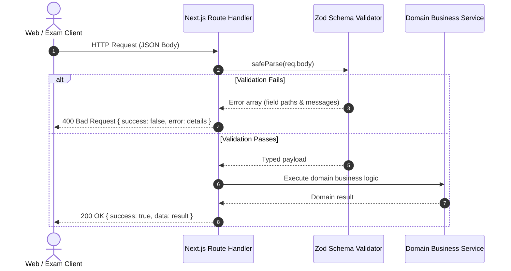

# 🔌 Engineering Standard: API Design & TETS Contracts

This document defines the RESTful API conventions, request/response envelopes, validation pipelines, and data table contracts implemented across TargetTNgrp4.

---

## 1. Standardized API Envelope (`ApiResponse<T>`)

To eliminate payload ambiguity between frontend components and backend services, every API route returns the standardized `ApiResponse<T>` envelope:

```typescript
export interface ApiResponse<T = any> {
  success: boolean;
  message: string;
  data?: T;
  error?: string;
}
```

### Response Formats:

#### Success Response (`200 OK` / `201 Created`):
```json
{
  "success": true,
  "message": "Question created successfully",
  "data": {
    "id": "f47ac10b-58cc-4372-a567-0e02b2c3d479",
    "questionText": "Who was the first female Chief Minister of Tamil Nadu?",
    "section": "Part B - General Studies"
  }
}
```

#### Error Response (`400 Bad Request` / `422 Unprocessable`):
```json
{
  "success": false,
  "message": "Validation failed for question payload",
  "error": "Field 'correctOption' must be one of ['A', 'B', 'C', 'D']"
}
```

---

## 2. Request Validation via Zod Schemas

All incoming request bodies, route parameters, and query strings are validated using centralized Zod schemas (`src/lib/validations/`) before reaching domain services:



---

## 3. Dual Route Guards

Route handlers enforce security boundaries via dedicated guard functions:

### Student API Guard:
```typescript
import { requireStudentApi } from "@/lib/auth/studentApi";

export async function POST(req: NextRequest) {
  const guard = await requireStudentApi(req);
  if (!guard.ok) return guard.response; // 401 Unauthorized
  
  const student = guard.user;
  // student.id is safely injected
}
```

### Admin API Guard:
```typescript
import { requireAdminApi } from "@/lib/auth/admin/session";

export async function POST(req: NextRequest) {
  const guard = await requireAdminApi(req);
  if (!guard.ok) return guard.response; // 401 / 403 Forbidden
  
  const admin = guard.admin;
  // admin.id verified against admin_sessions in DB
}
```

---

## 4. Universal Enterprise Table Standard (TETS) Contract

All data tables (Questions, Students, Payments) follow the standardized TETS query contract:

### 4.1 Query Parameters:
| Parameter | Type | Default | Description |
|---|---|---|---|
| `page` | `number` | `1` | 1-based page index. |
| `pageSize` | `number` | `10` | Rows per page (`10`, `20`, `50`, `100`). |
| `search` | `string` | `""` | 400ms debounced search string. |
| `status` | `string` | `"ALL"` | Active filter tab (`ALL`, `PUBLISHED`, `DRAFT`, etc.). |
| `section` | `string` | `"ALL"` | Section filter (`Part A`, `Part B`, `Part C`). |

### 4.2 Standard Paginated Envelope:
```json
{
  "success": true,
  "message": "Questions retrieved successfully",
  "data": {
    "items": [...],
    "pagination": {
      "page": 1,
      "pageSize": 10,
      "totalItems": 2450,
      "totalPages": 245
    },
    "tabCounts": {
      "all": 2450,
      "published": 2200,
      "draft": 250,
      "partA": 1200,
      "partB": 950,
      "partC": 300
    }
  }
}
```

### 4.3 Atomic Tab Count Execution:
To guarantee database consistency without multiple network round-trips, item lists and tab counts execute concurrently via `db.$transaction`:

```typescript
const [items, totalItems, tabCounts] = await db.$transaction([
  db.question.findMany({ where, skip, take }),
  db.question.count({ where }),
  // Aggregated counts for tab headers
  db.question.groupBy({ by: ['isPublished'], _count: true })
]);
```
