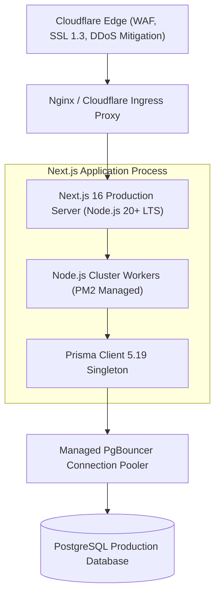

# 🚀 Engineering Guide: Deployment & Production Topology

This document details the production hosting architecture, database connection pooling, operational maintenance scripts, and security environment configuration for TargetTNgrp4.

---

## 1. Hosting Architecture & Runtime Environment

TargetTNgrp4 runs as a containerized or PM2-managed Node.js service paired with Cloudflare edge caching:



---

## 2. PostgreSQL Connection Pooling Strategy

To prevent database connection exhaustion during peak mock test windows:

- **Pooled Application Connection (`DATABASE_URL`):** Utilizes PgBouncer or Supabase transaction pooling on port 6543. All high-frequency student exam APIs, autosaves, and practice sessions route through this pooled connection.
- **Direct Administrative Connection (`DIRECT_URL`):** Connects directly to PostgreSQL primary on port 5432. Reserved exclusively for schema migrations (`prisma db push`), database seeding (`prisma db seed`), and administrative background jobs.
- **Prisma Singleton Invariant:** Ensures only one instance of `PrismaClient` is instantiated per Node.js process:
  ```typescript
  // src/lib/db.ts
  const globalForPrisma = globalThis as unknown as { prisma: PrismaClient };
  export const db = globalForPrisma.prisma || new PrismaClient();
  if (process.env.NODE_ENV !== "production") globalForPrisma.prisma = db;
  ```

---

## 3. Environment Variables & Secrets Management

| Variable Name | Sensitivity | Purpose & Description |
|---|---|---|
| `DATABASE_URL` | High | Pooled PostgreSQL connection string for API operations. |
| `DIRECT_URL` | High | Direct unpooled PostgreSQL connection string for migrations. |
| `STUDENT_JWT_SECRET` | Critical | HMAC secret used to sign stateless student session tokens. |
| `PAYMENT_SETTINGS_ENCRYPTION_KEY` | Critical | 32-byte hexadecimal key for AES-256-GCM gateway encryption. |
| `RAZORPAY_KEY_ID` | Medium | Public Razorpay key ID for client-side checkout initiation. |
| `RAZORPAY_KEY_SECRET` | Critical | Private Razorpay key secret for order creation and HMAC verification. |
| `ADMIN_DEFAULT_EMAIL` | High | Bootstrap email for initial admin provisioning script. |
| `ADMIN_DEFAULT_PASSWORD` | Critical | Bootstrap password for initial admin provisioning script. |

---

## 4. Operational Maintenance & CLI Scripts

The platform includes dedicated administrative maintenance scripts located in `scripts/`:

### 4.1 Admin Provisioning:
```bash
npm run admin:create
```
Safely initializes the super-administrator account from environment variables if no administrator exists in the database.

### 4.2 Expired Session Pruning:
```bash
npm run admin:prune
```
Executes a maintenance query purging expired records from `admin_sessions` and `login_attempts` older than 30 days to keep database indexes compact.

### 4.3 Full Release Gate Verification:
```bash
npm run verify
```
Runs the strict 3-tier release verification pipeline:
1. ESLint rule validation (`eslint`)
2. TypeScript strict type-checking (`tsc --noEmit`)
3. 150-line file length audit across all project source files (`node ../agents/scripts/count-lines.js`).
