# 🔐 Engineering Architecture: Dual Independent Authentication & Security

This document outlines the security architecture, dual authentication domains, session invalidation protocols, and credential protection implemented in TargetTNgrp4.

---

## 1. Why Dual Independent Authentication?

A SaaS exam platform balances two opposing operational demands:
- **Massive Student Concurrency:** During live mock exams, thousands of aspirants simultaneously submit autosaves, question navigations, and practice answers. Session checks must be **ultra-low latency and stateless** to avoid database bottlenecks.
- **Strict Administrative Governance:** Platform administrators possess question creation, bulk CSV import, and financial approval privileges. Admin sessions require **immediate single-click revocation, brute-force IP rate limiting, and immutable audit logs**.

To resolve this, TargetTNgrp4 implements **Dual Independent Authentication Gateways**:

```mermaid
flowchart TD
    subgraph StudentGateway["Student Auth Domain"]
        STU_REQ["Student Exam Traffic"] --> STU_COOKIE["Cookie: targettn_student_session"]
        STU_COOKIE --> JWT_VERIFY["Stateless JWT Signature Verification"]
        JWT_VERIFY -->|Valid| STU_EXEC["Execute Exam / Practice Endpoint (Zero DB Session Read)"]
    end

    subgraph AdminGateway["Administrator Auth Domain"]
        ADM_REQ["Admin Mutation Traffic"] --> ADM_ORIGIN["CSRF Origin Header Check"]
        ADM_ORIGIN --> ADM_COOKIE["Cookie: tnpsc_admin"]
        ADM_COOKIE --> HASH_TOKEN["Compute SHA-256 Token Hash"]
        HASH_TOKEN --> DB_SESSION["Lookup admin_sessions Table"]
        DB_SESSION -->|Active & Not Revoked| ADM_AUDIT["Log Action in admin_audit_logs"]
        ADM_AUDIT --> ADM_EXEC["Execute Administrative Mutation"]
    end
```



---

## 2. Student Authentication Specification

- **Session Vehicle:** HTTP-Only, Secure, `SameSite=Lax` cookie named `targettn_student_session`.
- **Token Format:** Signed JSON Web Token (JWT) with HS256 algorithm.
- **Payload Claims:**
  ```json
  {
    "sub": "user-uuid-v4",
    "email": "aspirant@example.com",
    "role": "STUDENT",
    "fullName": "Kavitha S",
    "iat": 1728000000,
    "exp": 1730592000
  }
  ```
- **Scale Advantage:** High-frequency exam runner calls (`/api/mock-tests/[id]/autosave`) verify token cryptographically in Node.js memory without executing a database read query.

---

## 3. Administrator Authentication Specification

- **Session Vehicle:** HTTP-Only, Secure, `SameSite=Strict` cookie named `tnpsc_admin`.
- **Opaque Token Invariant:** The raw token presented by the browser is **never stored in the database**. The server stores only its one-way cryptographic SHA-256 digest:
  $$\text{tokenHash} = \text{SHA-256}(\text{rawToken})$$
- **Instant Revocation:** Any administrator session can be immediately terminated by setting `revokedAt = now()` in `admin_sessions`.
- **Brute-Force Shield:** The `login_attempts` table tracks IP addresses and emails. Repeated failures trigger progressive exponential delays and IP throttling.
- **CSRF Origin Protection:** All state-mutating requests (`POST`, `PUT`, `DELETE`, `PATCH`) under `/api/admin/` verify that the request's `Origin` or `Referer` header strictly matches the authorized platform domain.

---

## 4. Payment Gateway Credential Encryption (AES-256-GCM)

Platform administrators can configure Razorpay and Cashfree credentials directly from the admin interface without redeploying code.

- **Symmetric Encryption at Rest:** Private keys and webhook secrets are encrypted using authenticated **AES-256-GCM** before database insertion in `payment_gateway_settings`:
  $$\text{Ciphertext} = \text{AES-256-GCM}(\text{SecretKey}, \text{MasterKey}, \text{IV})$$
- **Cryptographic Tag Verification:** Decryption validates the 16-byte GCM authentication tag, ensuring keys have not been tampered with at rest.
- **Webhook HMAC-SHA256 Verification:** Incoming webhooks from payment gateways compute and compare HMAC signatures against raw payload buffers before updating order states.
