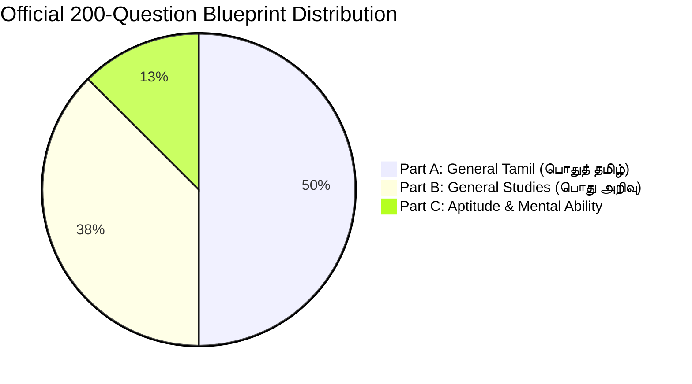
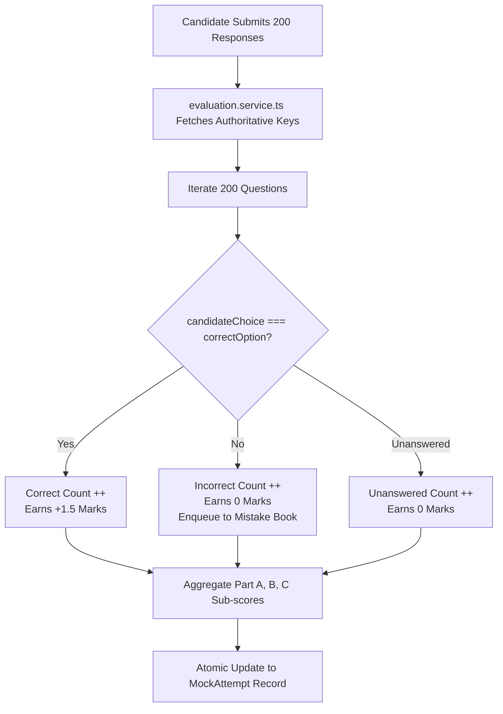
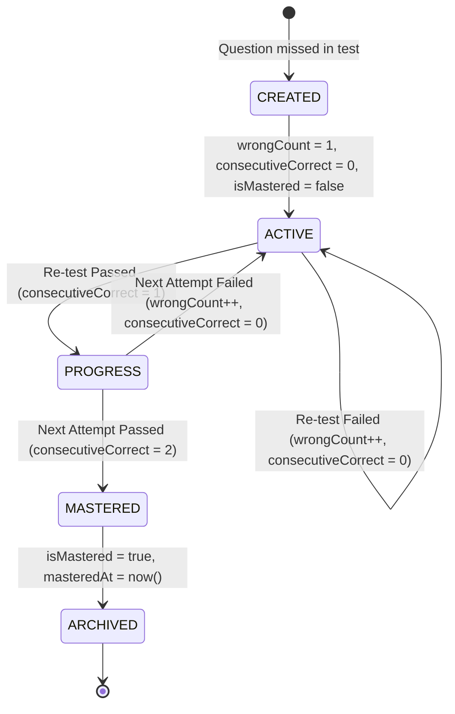

# ⚡ Engineering Architecture: Exam Engine & Server-Side Scoring

This document details the mechanics of the blueprint question sampling engine, zero answer leakage protocols, server-side scoring calculations, and the spaced-repetition Mistake Book algorithm.

---

## 1. Blueprint 200-Question Sampling Engine (`blueprint.service.ts`)

To assemble authentic mock exams matching the official TNPSC Group 4 syllabus, the sampling engine adheres to strict mathematical and curricular distributions:

### Curricular Distribution Matrix:
| Section | Questions | Marks | Curriculum Source & Units |
|---|---|---|---|
| **Part A: General Tamil** | **100** | **150.0** | 1. Ilakkanam (Grammar) 2. Ilakkiyam (Literature) 3. Tamil Scholars & Services (Samacheer Kalvi 6th–12th) |
| **Part B: General Studies** | **75** | **112.5** | 1. Indian Polity & Constitution 2. History & Culture of India 3. Indian National Movement 4. Geography of India & TN 5. Indian Economy 6. General Science 7. Current Events |
| **Part C: Aptitude** | **25** | **37.5** | 1. Simplification & Percentages 2. HCF & LCM 3. Ratio & Proportion 4. Simple & Compound Interest 5. Area, Volume, Time & Work |
| **Total** | **200** | **300.0** | **Exam Duration: 180 Minutes (3 Hours)** |

### Difficulty Calibration:
Mock assemblies enforce a balanced cognitive load:
- **Easy:** $\sim 30\%$ (Direct factual and recall questions)
- **Medium:** $\sim 50\%$ (Application and multi-statement matching questions)
- **Hard:** $\sim 20\%$ (Analytical, assertion-reasoning, and multi-step math problems)

---

## 2. Server-Side Scoring & Zero Leakage Invariant

### Authoritative Marking Formula:
Unlike competitive exams with negative marks, TNPSC Group 4 awards marks with **zero negative marking penalty**:
$$\text{Total Score} = \text{Total Correct Answers} \times 1.5$$
$$\text{Accuracy Percentage} = \left( \frac{\text{Total Correct}}{\text{Total Answered}} \right) \times 100$$

All evaluations occur inside `evaluation.service.ts` in an isolated backend transaction, ensuring client browsers never influence grading calculations.

---

## 3. Automated Mistake Book Spaced-Repetition Algorithm

The Mistake Book transforms examination errors into durable knowledge using a deterministic state transition machine:

### Mastery Threshold:
- A question enters the Mistake Book upon its first incorrect answer.
- To earn the **"Mastered"** status, the student must answer the question correctly **two consecutive times** during subsequent revision tests.
- Any future mistake on that question resets `consecutiveCorrect` to `0`, ensuring that lucky guesses do not permanently mark an item as mastered.
