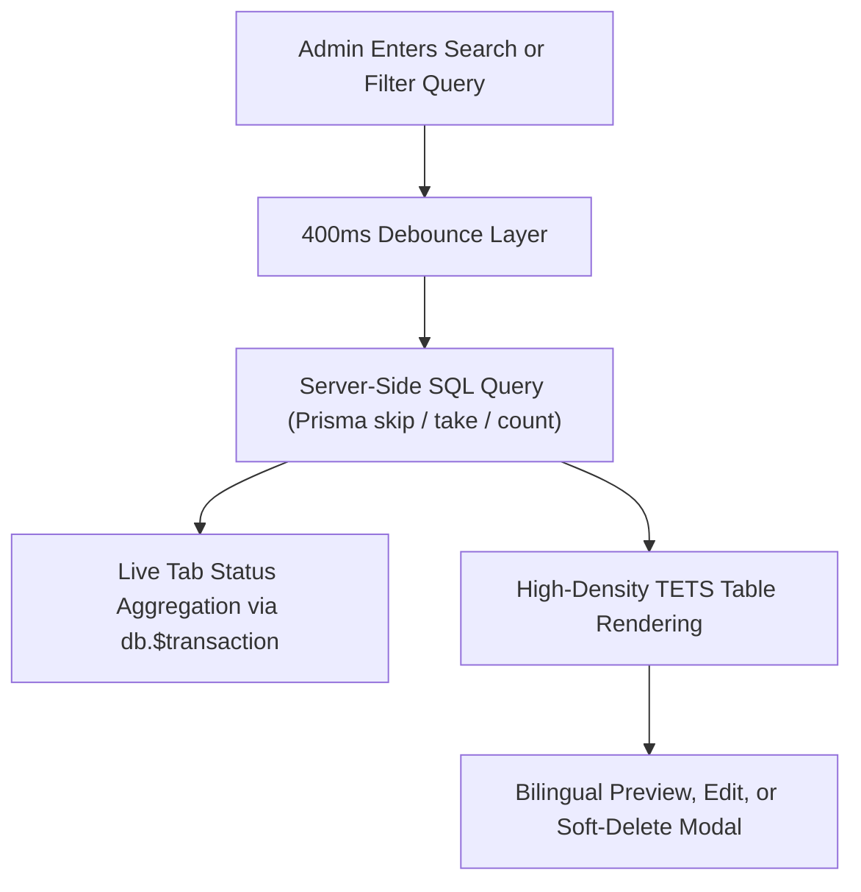
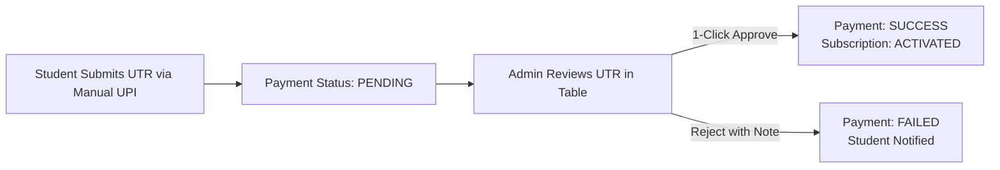

# 🛠️ Product Feature: Admin Management Console

The Admin Console (`/(admin)/admin`) provides operations, question curation, and financial governance tools for platform administrators.

---

## 1. Enterprise Question Bank Management (`/admin/questions`)

The question management console is engineered to handle 10,000+ bilingual questions with zero UI slowdown, conforming to the **Universal Enterprise Table Standard (TETS)**:

### Table Capabilities:
- **Server-Side Pagination:** Never pulls excessive rows to client memory; executes efficient `skip` and `take` queries at the database level.
- **Real-Time Status Tab Counts:** Dynamically aggregates counts for All Questions, Published, Draft, Part A, Part B, and Part C tabs using atomic database transactions.
- **Dynamic Rows per Page:** 10, 20, 50, or 100 rows per page with transparent "Showing X to Y of Z" status indicators.
- **Debounced Search (400ms):** Guarantees zero UI stutter while typing search queries across question texts or syllabus tags.

---

## 2. Bulk CSV Ingestion Pipeline (`/admin/bulk-import`)

Administrators can import hundreds of bilingual questions exported from spreadsheets in seconds:

1. **PapaParse Streaming Parser:** Parses CSV uploads row-by-row on the client with automated header normalization.
2. **Strict Zod Schema Validation:** Validates every question row against mandatory schema rules:
   - Non-empty bilingual texts (`questionText`, `questionTextTa`).
   - Valid option values (`A`, `B`, `C`, `D`).
   - Valid section mappings (`Part A`, `Part B`, `Part C`).
   - Valid difficulty tokens (`EASY`, `MEDIUM`, `HARD`).
3. **Pre-Commit Ingestion Preview:** Highlights syntax or formatting errors row-by-row with line numbers prior to database commit.
4. **Transactional Database Write:** Writes validated questions in atomic batches (`createMany`), ensuring zero partial or corrupted imports.

---

## 3. Mock Test Builder & Blueprint Sampler (`/admin/mocks`)

- **Automated Blueprint Sampling:** Generates authentic 200-question mock exams using `blueprint.service.ts` based on official syllabus proportions and difficulty distributions.
- **Manual Question Re-ordering:** Allows exam creators to adjust question presentation order across Part A, Part B, and Part C.
- **Publish State Gate:** Toggle mock visibility (`isPublished`, `isPremium`) with instant propagation to student catalogs.

---

## 4. Payment Governance & Manual UPI Approvals (`/admin/payments`)

- **Dual Payment Reconciliation:** Unified view displaying automated Razorpay transactions alongside direct manual UPI submissions.
- **UTR Verification Workflow:** Inspect candidate transaction references (UTR/UPI Ref), verify against bank statement, and activate student subscriptions with a single click.
- **Audited State Transitions:** Every payment approval or rejection logs the administrator ID, timestamp, and client IP in `admin_audit_logs`.

---

## 5. Security & Administrative Audit Logging

- **DB-Backed Session Invalidation:** All admin logins generate records in `admin_sessions`. Expired or suspicious sessions can be revoked immediately from the database.
- **Strict CSRF Origin Verification:** All administrative mutations verify the HTTP `Origin` header against the production domain to prevent Cross-Site Request Forgery.
- **Immutable Action Audit Trail:** Administrative activities (Question deletion, payment approval, bulk import) generate persistent `admin_audit_logs` records.
