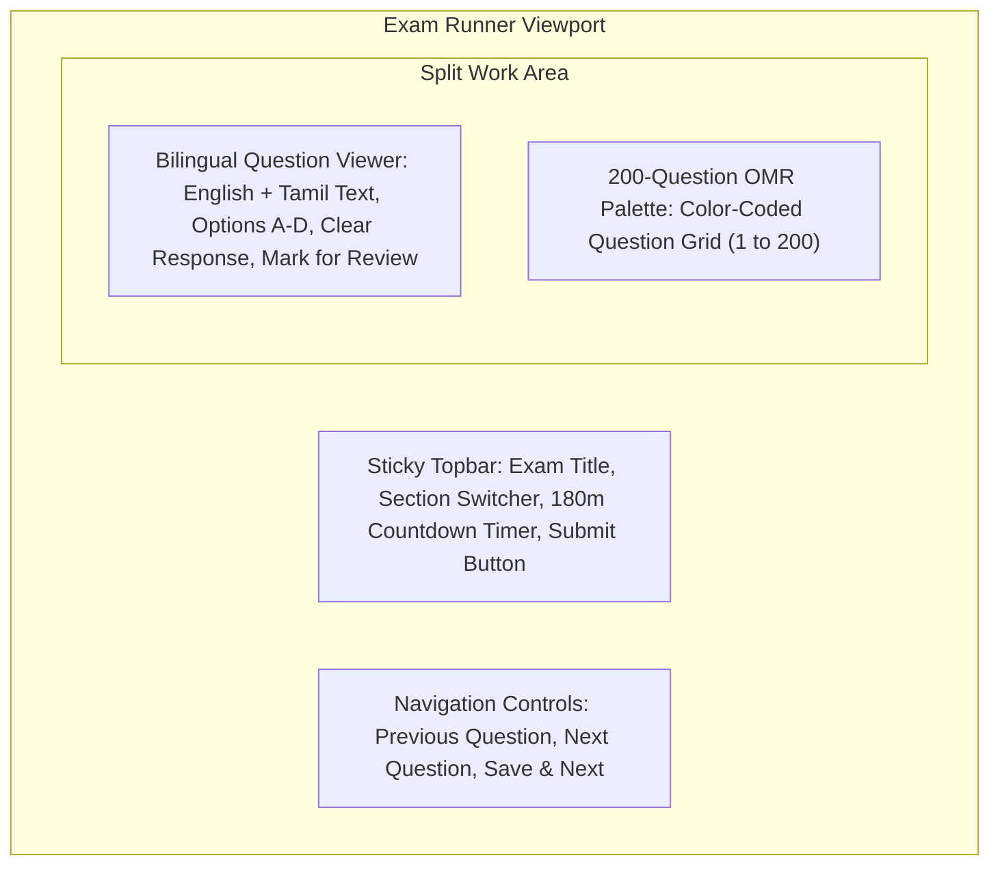

# ⏱️ Product Feature: Exam Simulation Runner

The Exam Runner (`/(student)/mock-tests/[id]/live`) is the centerpiece of TargetTNgrp4, replicating authentic TNPSC Group 4 examination conditions with zero distraction and high technical resilience.

---

## 1. Interface Layout & OMR-Style Question Palette

The live exam runner presents an authentic examination environment optimized for both desktop and mobile viewports:

### OMR Palette Status Invariants:
| Palette State | Color Coding | Description |
|---|---|---|
| **Answered** | 🟢 Emerald Green | Candidate has selected one of options A, B, C, or D. |
| **Marked for Review** | 🟣 Indigo / Violet | Question flagged for reconsideration before submission. |
| **Answered & Flagged**| 🔵 Cyan / Teal | Option selected, but explicitly marked for double-check. |
| **Visited / Unanswered**| 🟡 Amber | Question viewed by student, but no option selected yet. |
| **Not Visited** | ⚪ Slate Neutral | Question has not yet been opened or navigated to. |

---

## 2. Timer Synchronization & Auto-Submission

- **180-Minute Countdown:** Tracks remaining exam time in milliseconds, formatted as `HH:MM:SS`.
- **Urgency Warning Thresholds:**
  - **15 Minutes Remaining:** Subtle color shift to Amber alert.
  - **5 Minutes Remaining:** Pulsing Red alert with audio/visual notification.
- **Fail-Safe Automatic Submission:** When the countdown reaches `00:00:00`, the active exam runner automatically locks all option inputs and submits current candidate answers to `/api/mock-tests/[id]/submit`.

---

## 3. Persistent Autosave & Network Disruption Resilience

To safeguard aspirants practicing over unstable mobile networks in rural Tamil Nadu:

1. **Dual-Tier State Storage:**
   - **Tier 1 (Instant Local Buffer):** Every option click or flag toggle immediately updates React state and browser `localStorage`.
   - **Tier 2 (Debounced Server Sync):** Candidate responses are batched and dispatched asynchronously to `/api/mock-tests/[id]/autosave`.
2. **Crash & Refresh Recovery:** If a student accidentally refreshes their browser, loses power, or closes the tab, reopening the exam route seamlessly restores the countdown timer and all previously selected answers.

---

## 4. Zero Answer Leakage Security Invariant

To preserve the validity of simulated rankings:
- **Sanitized Live API Contract:** The live mock endpoint (`/api/mock-tests/[id]/live`) returns only question texts, option texts, section tags, and question IDs.
- **Server Evaluation Exclusivity:** `correctOption`, `explanation`, and `explanationTa` are strictly omitted from the database query payload and live JSON response.
- **Tamper Resistance:** Inspecting browser DevTools or intercepted network packets reveals zero answer keys.

---

## 5. Instant Scorecard & Diagnostic Review (`/results`)

Upon submission, candidates receive an instant scorecard:
- **Total Marks Achieved:** Computed at $1.5$ marks per correct answer ($\text{Max: } 300$).
- **Section Breakdown:**
  - Part A (Tamil): Marks out of $150$ ($100$ Questions).
  - Part B (General Studies): Marks out of $112.5$ ($75$ Questions).
  - Part C (Aptitude): Marks out of $37.5$ ($25$ Questions).
- **Time Analysis:** Total examination time consumed and average speed per question.
- **Cutoff Predictor:** Projected selection status based on category benchmarks.
- **Mistake Auto-Sync:** All incorrectly answered questions are instantly synchronized to the student's personal Mistake Book for future revision.
