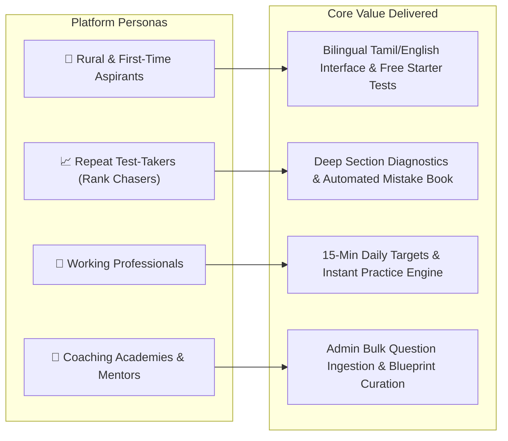

# 📖 Product Overview — TargetTNgrp4

TargetTNgrp4 is an enterprise-grade mock examination and aspirant operating platform purpose-built for the Tamil Nadu Public Service Commission (TNPSC) Group 4 examination ecosystem.

---

## 1. Exam Context & Aspirant Realities

The TNPSC Group 4 examination is Tamil Nadu's flagship recruitment exam for critical administrative and local governance positions, including:
- **Village Administrative Officer (VAO)**
- **Junior Assistant (Non-Security & Security)**
- **Typist & Steno-Typist**
- **Bill Collector & Field Assistant**

### The Statistical Reality:
- **Applicant Volume:** Over **2.0 to 2.2 million aspirants** register per notification cycle.
- **Total Vacancies:** Typically between **6,000 to 10,000 posts**.
- **Selection Ratio:** Approximately **1 candidate selected per 250 to 300 applicants**.
- **Cutoff Benchmark:** General category selection cutoffs routinely reach **260–275 marks out of 300** (representing an accuracy of $\ge 88\%$).

---

## 2. Who TargetTNgrp4 Serves

---

## 3. Product Pillars

### 3.1 Uncompromising Blueprint Authenticity
TargetTNgrp4 matches the official TNPSC Group 4 blueprint:
- **Part A (General Tamil / பொதுத் தமிழ்):** 100 Questions (150 Marks). Strict coverage of Ilakkanam (Grammar), Ilakkiyam (Literature), and Tamil Scholars from Samacheer Kalvi books (Classes 6–12).
- **Part B (General Studies / பொது அறிவு):** 75 Questions (112.5 Marks). Comprehensive coverage across History, Indian Polity, Geography, Economy, Science, and Tamil Nadu Heritage (Units 8 & 9).
- **Part C (Aptitude & Mental Ability / திறனறிவும் மனக்கணக்கும்):** 25 Questions (37.5 Marks). Time-sensitive quantitative aptitude (Simplification, Ratio, HCF/LCM, Simple/Compound Interest, Area/Volume).

### 3.2 Automated Spaced-Repetition "Mistake Book"
In traditional paper mock tests, students correct errors once and quickly forget them. TargetTNgrp4 automatically captures every incorrect answer into a persistent "Mistake Book". Candidates can re-test exclusively against their historical mistakes until achieving consecutive correct answers to earn "Mastered" status.

### 3.3 Zero-Leakage Live Exam Simulation
The exam engine reproduces real examination conditions with a strict 180-minute countdown timer, section navigation palette, mark-for-review flags, and automatic submission upon timer expiry. Critical exam integrity is protected via server-side scoring where answer keys are never exposed in browser network requests.

### 3.4 Inclusive & Transparent Pricing
Monetization is designed for aspirant accessibility:
- Free Starter Mock Tests and daily topic tests.
- Affordable 30-Day and 90-Day All-Access Passes.
- Dual payment gateways: Instant Razorpay checkout alongside direct QR-code UPI payment with admin UTR approval.
