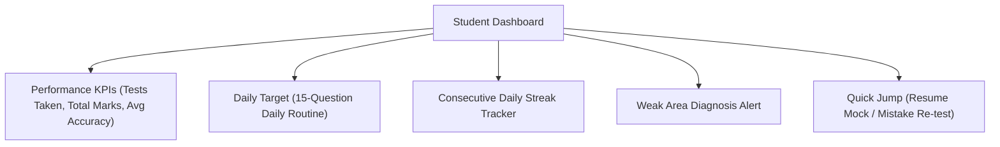
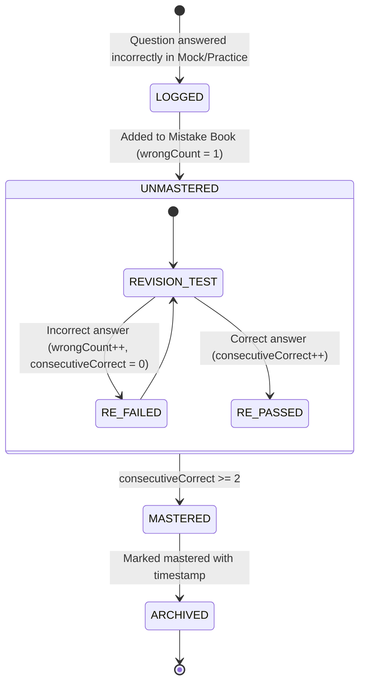

# 🎓 Product Feature: Student Portal & Learning Engine

The Student Portal (`/(student)`) provides an all-in-one preparation environment for TNPSC Group 4 aspirants, transforming passive memorization into active, data-driven mastery.

---

## 1. Student Dashboard & Habit Formation

### Key Modules:
- **Daily Target Routine:** A curated 15-question sprint scheduled for the current IST date. Completing the daily target increments the student's study streak.
- **Streak & Consistency Engine:** Visual streak counter encouraging uninterrupted daily practice leading up to exam day.
- **District Demographic Context:** Profiles map to one of Tamil Nadu's 38 revenue districts, enabling regional cohort analysis and peer benchmarks.

---

## 2. Topic-Wise Practice Engine (`/practice`)

For aspirants building foundational syllabus knowledge before attempting 200-question full mocks:

1. **Taxonomy Selection:** Students select Section (e.g. Part A General Tamil) $\rightarrow$ Unit (e.g. பொதுத் தமிழ் - பகுதி (அ) இலக்கணம்) $\rightarrow$ Specific Topic (e.g. வேர்ச்சொல் அறிதல்).
2. **Instant Feedback Mode:** Immediate answer validation with green/red indicator, detailed bilingual rationales, and textbook source references.
3. **Session Telemetry:** Tracks time spent per question to identify cognitive hesitation and pacing issues.

---

## 3. Automated Spaced-Repetition "Mistake Book" (`/mistake-book`)

### Mistake Book Capabilities:
- **Zero Manual Effort:** Students never need to copy-paste or maintain manual notebooks; every mistake is automatically captured.
- **Targeted Re-test Sessions:** Candidates can launch custom 10- or 25-question re-tests drawn exclusively from their unmastered mistakes.
- **Filter by Subject & Difficulty:** Quickly drill into recurring grammar mistakes or specific aptitude topics.

---

## 4. Bookmarks Repository (`/bookmarks`)

- **Instant Staring:** Aspirants can bookmark tricky or high-probability exam questions directly from any practice or review screen.
- **Personal Annotations:** Allows candidates to attach personal memory hooks, mnemonics, or textbook page numbers directly to the question record.

---

## 5. Academic Analytics & Diagnostics (`/analytics`)

- **Part A / Part B / Part C Performance Split:** Granular breakdown pinpointing whether score deficits stem from Tamil literature, general studies, or mental ability.
- **Accuracy vs. Speed Quadrant:** Identifies questions answered quickly and correctly (Strengths), slowly and correctly (Overthinking), quickly and incorrectly (Careless errors), or slowly and incorrectly (Knowledge gaps).
- **Cutoff Predictor:** Compares the candidate's recent 3-test average against historical district and category selection cutoffs.

---

## 6. Live Virtual Study Room (`/study-room`)

- **Synchronous Topic Sprints:** Aspirants join synchronized 15-question mini-tests on specific syllabus units alongside thousands of simultaneous candidates across Tamil Nadu.
- **Live Leaderboard:** Real-time ranking based on combined score and speed, simulating high-pressure exam hall conditions.
